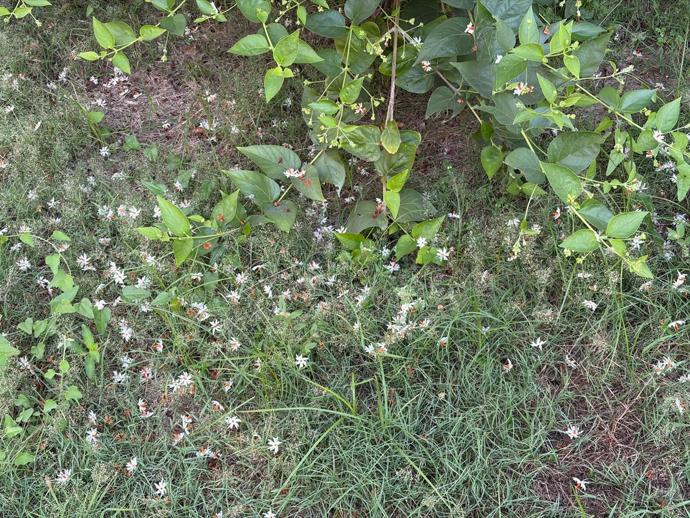

# Flower Counter (Android, Kotlin + OpenCV)

Native Android app that photographs small white flowers in grass and gives a **rough count**
using OpenCV colour thresholding, morphology and `SimpleBlobDetector`. Three sliders let you
tune the detection live because lighting and camera distance vary from photo to photo.



The sample photo above (night-flowering jasmine / parijat on grass) is bundled in the app and
shown on the start page, so the pipeline can be tried without going outside.

## Features

- Start page with the bundled sample photo: **Count sample**, **Capture & Count** (CameraX), or **Pick photo**
- Result view: red circles = individually detected flowers, orange outlines = clusters of
  touching flowers whose count is estimated from their area
- Live sliders: **White Sensitivity**, **Min Blob Size**, **Blur Amount**
- Toggles: cluster estimate on/off, show the binary mask (handy while tuning)
- Pinch to zoom / drag to pan the result, double-tap to reset
- Runtime camera permission with rationale and "Open Settings" fallback

## Tech stack

| Part | Version |
| --- | --- |
| Kotlin / Jetpack Compose (Material 3) | 1.9.24 / BOM 2024.06.00 |
| CameraX | 1.3.4 |
| OpenCV for Android | 4.10.0 (Maven Central) |
| Android Gradle Plugin / Gradle | 8.5.2 / 8.7 |
| minSdk / targetSdk | 24 / 34 |

## Build and run

Requirements: Android Studio (JDK 17) and an Android SDK with platform 34.

```bash
git clone https://github.com/hsmazumdar/FlowerCounter.git
cd FlowerCounter
./gradlew installDebug        # Windows: gradlew.bat installDebug
```

Or open the folder in Android Studio and press Run. If Gradle can't find the SDK, create
`local.properties` with `sdk.dir=/path/to/Android/Sdk`.

## Importing OpenCV

**Option A - Maven Central (used here).** Since 4.9.0 OpenCV publishes an official AAR with
native libraries for all ABIs:

```kotlin
// settings.gradle.kts -> dependencyResolutionManagement.repositories { mavenCentral() }
// app/build.gradle.kts
dependencies {
    implementation("org.opencv:opencv:4.10.0")
}
```

Initialise once, before any OpenCV call (done in `FlowerCounterApp.onCreate`):

```kotlin
val ok = OpenCVLoader.initLocal()
```

**Option B - SDK module.** Download `opencv-4.x-android-sdk.zip` from
[opencv.org/releases](https://opencv.org/releases/), copy `OpenCV-android-sdk/sdk` into the
project as `:opencv`, add `include(":opencv")` to `settings.gradle.kts` and
`implementation(project(":opencv"))` to the app. Initialisation is the same.

## Detection pipeline (`FlowerCounter.kt`)

1. Downscale so the long side is 1280 px, so slider values mean the same thing for every camera.
2. RGBA -> RGB -> **HSV**. White petals are bright *and* colourless even in shade, while
   leaf highlights keep a green tint; HSV separates brightness (V) from colourfulness (S),
   which RGB mixes together.
3. Threshold: `V >= minBrightness` and `S <= maxSaturation` (both driven by White Sensitivity).
4. Morphological **close** (5 px) fills each flower's orange centre.
5. **Gaussian blur** of the mask and re-threshold to smooth jagged outlines.
6. Morphological **open** (kernel ~ sqrt(Min Blob Size)) erases specks, grass blades, leaf-vein
   glare and petal tips, leaving a compact round core per flower.
7. `SimpleBlobDetector`: area `minArea..5000`, circularity >= 0.5, convexity >= 0.7,
   inertia >= 0.3. (The Java API can't set `blobColor`, so it runs on the inverted mask.)
8. Optional cluster estimate: large blobs the detector rejected are counted as
   `area / typical flower area` (90th percentile of detected blob areas).

On the bundled sample with default settings this gives about 340 flowers (about 236 detected
individually plus about 106 estimated in clusters).

## Tuning tips

| Problem | Try |
| --- | --- |
| Leaf glare or grass counted | Lower **White Sensitivity** |
| Shaded flowers missed | Raise **White Sensitivity** |
| Many tiny false hits | Raise **Min Blob Size** |
| Small or distant flowers missed | Lower **Min Blob Size** |
| Ragged blobs, flowers split in two | Raise **Blur Amount** |
| Neighbouring flowers merged | Lower **Blur Amount** |

Overlapping flowers remain a known limitation; treat the result as an estimate.

## Desktop tuning script

`tools/tune_flower_counter.py` mirrors the app's pipeline in Python, for picking defaults from
a photo on a PC:

```bash
pip install opencv-python numpy
python tools/tune_flower_counter.py photo.jpg            # parameter sweep
python tools/tune_flower_counter.py photo.jpg --render   # writes photo_result.jpg and photo_mask.png
```

## Project layout

```
app/src/main/
  assets/FlowerCounting.jpeg        bundled sample photo
  java/com/flowercounter/
    FlowerCounterApp.kt             OpenCV initialisation
    MainActivity.kt                 navigation between start page, camera and results
    FlowerViewModel.kt              state + debounced re-processing on slider changes
    FlowerCounter.kt                OpenCV pipeline
    ImageLoading.kt                 camera / gallery / asset decoding
    ui/HomeScreen.kt, CameraScreen.kt, ResultScreen.kt, Theme.kt
tools/tune_flower_counter.py        desktop mirror of the pipeline
```
